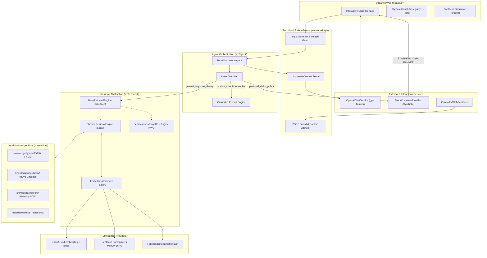
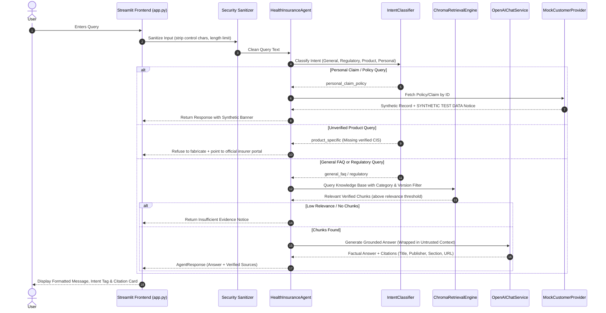

# System Architecture: India Health Insurance AI Agent

This document details the architectural design, component interactions, security boundaries, and AWS cloud migration path for the India Health Insurance AI Agent.

---

## 1. High-Level Architecture Diagram



---

## 2. Sequence Diagram: Query Processing Flow



---

## 3. Dual Independent Credential Architecture

To prevent cross-service key leakage and support separate OpenAI organization accounts or rate limits:

| Environment Variable | Service Responsibility | Default Value | Notes |
| :--- | :--- | :--- | :--- |
| `OPENAI_API_KEY` | Chat Answer Generation | None (Required for LLM generation) | Read exclusively by `OpenAIChatService` |
| `OPENAI_MODEL` | Chat Completion Model | `gpt-4o-mini` | Low temperature (0.1) for factual precision |
| `EMBEDDING_PROVIDER` | Embedding Mode Selector | `openai` | Options: `openai` or `local` |
| `OPENAI_EMBEDDING_API_KEY` | Vector Embeddings | None (Required if `openai` provider) | Read exclusively by `OpenAIEmbeddingProvider` |
| `OPENAI_EMBEDDING_MODEL` | Vector Embedding Model | `text-embedding-3-small` | 1536-dimensional embeddings |
| `LOCAL_EMBEDDING_MODEL` | Local Offline Model | `sentence-transformers/all-MiniLM-L6-v2` | Used when `EMBEDDING_PROVIDER=local` |

### Embedding Model Compatibility Check
When `ChromaRetrievalEngine` connects to a persistent collection, it checks collection metadata (`embedding_model` and `dimension`). If a mismatch is detected (e.g., trying to query a `text-embedding-3-small` collection with `all-MiniLM-L6-v2`), the engine raises an explicit `ValueError`, preventing silent dimension corruption.

---

## 4. Controlled Public Web Retrieval & SSRF Defense

When optional live web retrieval is invoked:
1. **Pre-flight SSRF Validation:** `validate_url_for_ssrf(url)` checks scheme (`http`/`https`), ensures destination is in the approved official domain allowlist (`irdai.gov.in`, `bimabharosa.irdai.gov.in`, etc.), and resolves DNS to ensure the destination IP is not private (`10.0.0.0/8`, `192.168.0.0/16`, `172.16.0.0/12`), loopback (`127.0.0.1`), or AWS instance metadata (`169.254.169.254`).
2. **Redirect Safety:** Head responses are inspected; if redirected, the target URL is re-validated through the complete SSRF check.
3. **Resource Capping:** Maximum content download is capped at `1,048,576 bytes` (1 MB) with connection timeout enforcement.
4. **Untrusted Wrapper:** Downloaded text is treated as untrusted data, wrapped in context tags, and never executed as prompt instructions.

---

## 5. AWS Cloud Migration Architecture

When migrating from local ChromaDB to AWS:

```
[Approved Source Documents] 
         │
         ▼
[Amazon S3 Bucket (Versioned & Encrypted)]
         │
         ▼
[Amazon Bedrock Knowledge Base] ── Titan Embeddings
         │
         ▼
[Bedrock Knowledge Base Runtime Retrieve API]
         │
         ▼
[BedrockKnowledgeBaseEngine] (Implements BaseRetrievalEngine)
         │
         ▼
[Agent Orchestrator]
```

- **S3 Bucket:** Hosts approved official circulars and verified Customer Information Sheets (CIS) with SSE-S3 encryption.
- **Bedrock Knowledge Bases:** Managed vector store (OpenSearch Serverless or Aurora PostgreSQL pgvector).
- **Secrets Manager:** Stores external API credentials with automatic secret rotation.
- **IAM Policies:** Follow least-privilege principles (`bedrock:Retrieve` only for knowledge base role).
